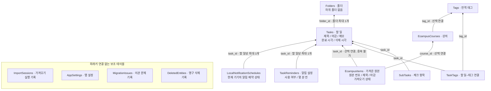

# DB v6 관계도

이 문서는 v6 시점 기록이다. 현재 구조는 [DB v7 관계도](db-v7.md)를 참고한다.

기준: 2026-10-30, [실제 Drift 스키마](../../lib/data/local/app_database.dart)의 `schemaVersion = 6`.
화살표는 외래키가 참조하는 방향이다. 화면 DTO가 아닌 현재 저장 테이블 13개를 표시한다.

[Mermaid 원본](db-v6.mmd)을 Mermaid 지원 도구에 넣어 이미지로 변환할 수 있다. 원본에는 코드 블록 표시 없이 그래프 문법만 들어 있다.

## 읽는 기준

- 할 일은 폴더에 속하지 않거나 하나의 폴더에 속한다. 폴더에는 여러 할 일이 들어간다. 폴더 계층은 없다.
- 태그는 폴더와 독립적이다. `task_tags`의 `(task_id, tag_id)` 복합 기본키로 할 일과 태그를 다대다 연결한다.
- eCampus 원본 하나와 할 일 하나는 서로 최대 하나씩 연결된다. `imported` 원본은 할 일 연결이 필수이고, `ignored`·`unreviewed` 원본은 연결하지 않는다. 직접 만든 개인 일정에는 원본이 없다.
- `ecampus_courses.tag_id`는 선택적인 강의–전역 태그 연결이다. 현재 가져오기가 태그를 자동 생성하거나 연결하지 않는다.
- `task_reminders`는 알림 규칙, `local_notification_schedules`는 이 기기의 예약 결과다. 각각 할 일당 최대 한 행이다.
- 보조 테이블 4개는 현재 외래키가 없다. `entity_id`·`source_scope_id` 같은 이름만으로 실제 연결선을 만들지 않았다. 영구 삭제 기록은 향후 동기화 준비이며 기기 간 동기화는 아직 구현하지 않았다.
- `legacy_v5_*`는 기존 DB 이관 시 원본을 보관하는 테이블이다. 현재 운영 스키마와 구분해 그림에서 제외했다.

## 작업·검증 기록

- [개선 작업 기록](../개선%20작업%20기록.md): DB-005 구현, DB-006 기기 설치, DB-007 관계도·Git 정리.
- [측정·검증 자료 안내](../evidence/db/README.md): 전후 측정 원본, 테스트·빌드 결과, 설치 기록.
- [비교와 적용안](../specifications/DB%20재설계%20비교와%20적용안.md): Kotlin·Flutter 비교와 변경 전 문제.
