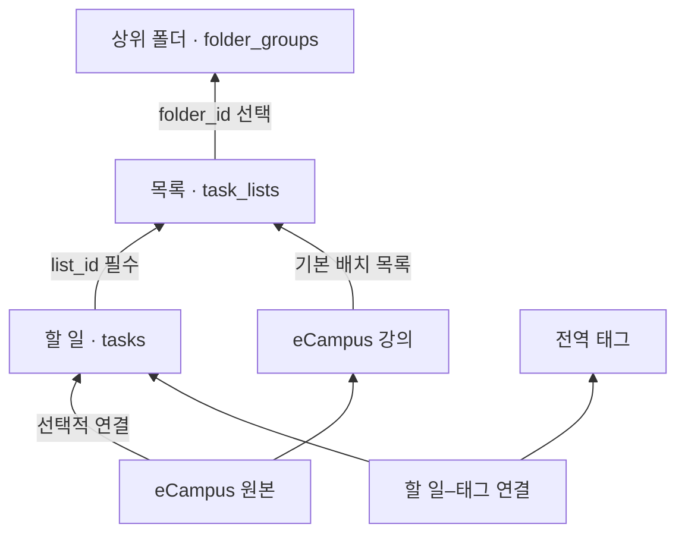

# DB v7 — 상위 폴더·목록·할 일

최신 저장 구조는 [app_database.dart](../../lib/data/local/app_database.dart) 기준이다.
[변환용 Mermaid 원본](db-v7.mmd)은 Markdown 코드 블록 없이 그래프 문법만 저장했다.

- 모든 저장 Task는 목록 하나에 속한다. 상위 폴더를 Task의 소속으로 저장하지 않는다.
- 직접 만든 Task의 기본 목록은 수집함(`kutodo:inbox`)이다. 수집함은 보관·이름 변경·폴더 이동이 불가능하다.
- 목록은 상위 폴더에 속하지 않을 수도 있다. 폴더 중첩·목록 중첩은 지원하지 않는다.
- 관리 화면에서 폴더를 누르면 목록만 펼치거나 접는다. 목록을 길게 눌러 폴더로 이동하거나 ‘폴더 밖’에 놓을 수 있고, 목록을 누르면 해당 할 일을 연다. 수집함도 색상을 바꿀 수 있는 네모 아이콘의 고정 목록이다.
- 완료·휴지통 이동은 시각만 변경한다. 목록 소속은 그대로 유지하며 휴지통 복원 후에도 보존한다.
- 목록은 물리 삭제 대신 보관한다. Task·완료·휴지통·원본의 연결은 유지하고 관리 화면에서 목록을 복원한다. 폴더 삭제는 목록을 폴더 밖으로 꺼낸다.
- eCampus NEW의 기본 배치는 `eCampus 폴더 → 강의별 목록 → Task`다. 강의 식별값으로 기본 목록을 찾으며 이름으로 합치지 않는다. 가져오기에서 수집함·다른 목록을 직접 선택할 수도 있다.
- 재가져오기는 기존 Task의 목록을 유지한다. 사용자가 Task나 목록을 옮겨도 자동 배치가 되돌리지 않는다. 보관한 과목 목록은 새 Task 때문에 다시 열지 않고 새 목록을 만든다.
- 전체·오늘·예정·완료는 기존 상태·날짜 기반 조회다. 별도의 저장 목록으로 만들지 않는다. 전역 태그도 폴더·목록 소속과 독립적이다.

내부 호환 경계: 기존 화면의 `Folder`/`FolderRepository`와 `Task.folderIds`, Drift의 `Tasks.folderId` 이름은 어댑터로 유지한다. 실제 저장은 `task_lists`와 NOT NULL `tasks.list_id`다. `Task.listId`가 단일 목록을 나타내며 `Folder.groupId`는 상위 폴더를 나타낸다. 이 경계가 상위 폴더에 Task를 직접 연결한다는 뜻은 아니다.

## 이관

- v6의 기존 폴더는 같은 ID·이름·보관 상태를 가진 목록으로 옮긴다. 기존 소속은 유지하고 소속 없는 Task만 수집함에 넣는다.
- 완료·삭제 시각, 메모·태그·하위 항목·원본 연결은 보존한다. 원본 행은 `legacy_v6_tasks`, `legacy_v6_lists`에도 보관한다.
- v5 설치본은 기존 원본 보존·예외 기록 경로를 거쳐 v7로 직접 이관한다.
- [v7 검증 기록](../evidence/db-v7/README.md), [작업 기록 DB-010](../개선%20작업%20기록.md).
