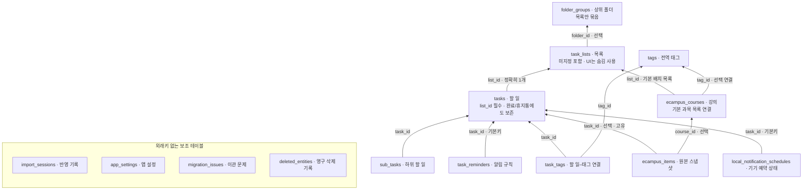

# DB v7 — 폴더·목록·할 일

현재 기준: 2026-11-15 / [실제 Drift 스키마](../../lib/data/local/app_database.dart).
[Mermaid 원본](db-v7.mmd)과 [DBML](../database.dbml)을 변환 도구에 넣을 수 있다.

- Tasks는 목록 하나에 필수 소속되고 상위 폴더를 직접 참조하지 않는다.
- 미지정은 기본 고정 목록이다. 완료·휴지통·복원 후에도 소속을 보존한다.
- 태그는 폴더·목록과 독립적이다. 위젯은 현재 태그 대신 소속 목록명/색상을 표시한다.
- 목록 보관/복원 UI는 제거됐고 숨김을 사용한다. 저장소의 deleted_at 및 과거 데이터 호환 경로와 UI 기능을 구분한다.
- 신규 eCampus 기본 배치는 eCampus 폴더 아래 강의별 목록이다. 기존 수동 이동은 재가져오기에서 유지한다.
- EcampusItems는 원본, Tasks는 사용자 작업이다. 제외는 ignored 원본이며 별도 Task 행이 아니다.
- ImportSessions는 반영 성공 기록이며 계정/로그인 세션 테이블이 아니다.
- task_reminders 규칙과 local_notification_schedules의 기기 예약 결과를 분리한다.
- 삭제 기록과 안정 ID는 기기 간 동기화 구현 완료를 뜻하지 않는다.

v6의 폴더는 v7 목록으로 보존하며 소속 없는 Task는 미지정에 넣는다.
이관 원본·예외 기록은 legacy_*·migration_issues에 남을 수 있고 이 그림의 활성 14개 테이블과 구분한다.
세부 호환 이름은 [데이터 모델](../데이터%20모델.md), 도입 당시 검증은 [v7 증거](../evidence/db-v7/README.md)를 본다.
