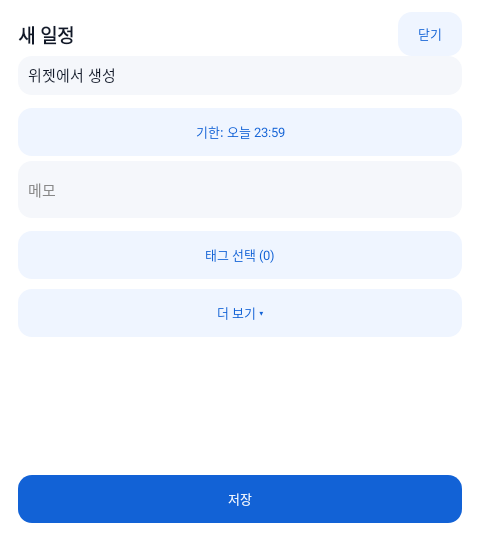
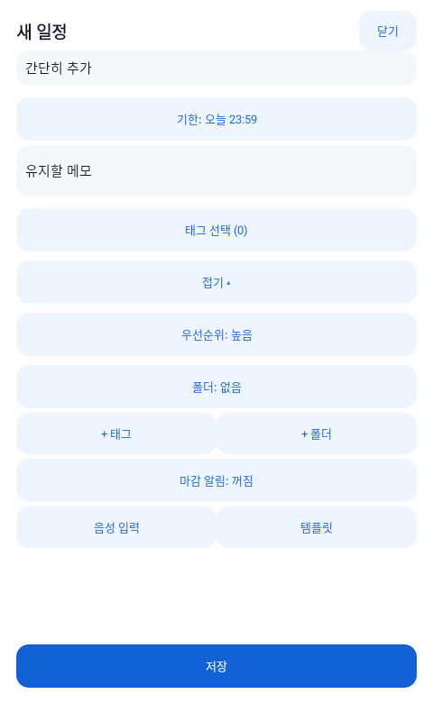
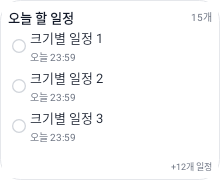
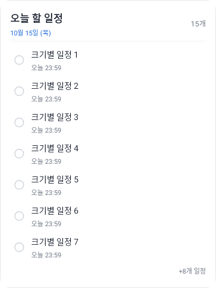
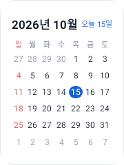
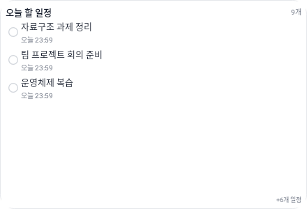
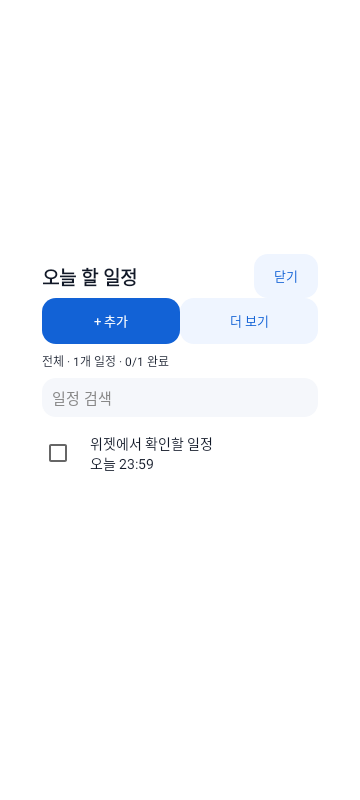
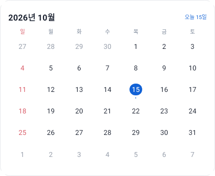

# Android 위젯 기능 확장

최초 기준: `main`의 `7fabd85`. 기본 위젯 간소화·캘린더 추가의 기준: `12aa89f`. 입력 간소화·크기 조절 개선의 기준: `98be522`. 작업 브랜치: `codex/widget-workspace-actions`.

## 사용 방식

오늘·주간 위젯은 흰색 카드와 파란 강조색을 유지하며 제목·개수·일정 목록을 표시한다. 넓은 카드에는 날짜·마감 정보를 함께 보여주고, 작은 타일에서는 헤더를 줄이거나 제목 한 줄로 표시한다. 기본 화면에는 추가·설정·새로고침·진행률·페이지 버튼을 놓지 않는다. 체크 모양은 완료 여부를 보여주는 표시이며, 기본 화면에서 상태를 바꾸지 않는다. 목록이 길면 남은 개수를 `+N개 일정`으로 표시한다.

- 위젯의 제목·빈 공간·일정 행: 현재 필터의 전체 목록을 팝업으로 확대한다. 일정 행을 눌러도 먼저 목록이 열린다.
- 확장 목록: 추가·캘린더·더 보기, 검색, 완료 체크, 제목을 통한 편집을 제공한다. 진행 개수도 이 화면에서 확인한다.
- 더 보기: 필터·설정, 전체·중요·삭제/제외 목록, 중요도·긴급도, 집중 타이머, 되돌리기, 로컬 새로고침을 제공한다.
- 월간 캘린더 위젯: 이번 달 달력, 오늘 강조, 일정이 있는 날짜의 점만 표시한다. 날짜를 누르면 해당 날짜가 선택된 캘린더 팝업이 열리고, 그 날짜에 추가하거나 일정을 수정·완료할 수 있다.
- 팝업은 중앙의 둥근 카드로 나타나며, 배경을 약하게 어둡게 하고 확대·축소 애니메이션을 사용한다. 닫기·뒤로·바깥 영역 터치로 홈 화면으로 돌아간다. 작성 중인 변경 사항이 있으면 버리기 확인을 먼저 표시한다.

Flutter 메인 화면을 열거나 Flutter 엔진을 실행하지 않는다. 텍스트·날짜 입력은 Android RemoteViews에 직접 넣을 수 없으므로 네이티브 대화상자 Activity로 위젯 확장 경험을 구현한다. 홈 화면의 위젯 자체 크기가 변경되는 것은 아니며, 홈 화면 위에 별도 팝업 창이 뜨는 방식이다. 저장한 내용은 같은 DB와 세 위젯에 즉시 반영한다.

### 간결한 일정 입력

새 일정·수정 화면은 **제목 → 기한 → 메모 → 태그 선택** 순서로 표시하고, 저장 버튼은 아래에 고정한다. 우선순위·폴더·태그/폴더 생성·알림·음성·템플릿과 기존 항목의 추가 관리 기능은 처음에는 접혀 있는 **더 보기** 안에 둔다. 별도의 입력 필드 환경설정을 추가하지 않는다.

더 보기를 펼치거나 접을 때 화면을 다시 만들지 않으므로 제목·메모·기한·태그·추가 옵션 값이 유지된다. 접기만으로 값이 초기화되거나 자동 저장되지 않는다. 기한 선택창의 **기한 없음**을 선택하면 추가 옵션을 열 필요 없이 날짜와 마감 알림을 함께 해제한다. 학업 일정의 원본 마감 보호는 유지한다.

| 기본 입력 | 더 보기 |
| --- | --- |
|  |  |

### 위젯 크기 조절

위젯을 홈 화면에 놓은 뒤 길게 누르고 조절 핸들을 드래그한다. 기존에도 가로·세로 resizeMode는 켜져 있었지만 큰 최소 배치 크기가 축소를 막았다. 이번에는 별도의 minResizeWidth·minResizeHeight를 지정하고 크기에 맞춰 실제 내용을 다시 배치한다. 사용 가능한 칸 수와 조절 방식은 런처에 따라 다르다.

| 위젯 | 기본 배치 목표(Android 12 이상) | 축소 하한 | 크기에 따른 동작 |
| --- | --- | --- | --- |
| 오늘 할 일정 | 3×2칸 | 140×72dp | 작은 타일은 제목 한 줄, 중간 크기는 마감 보조 문구, 넓은 카드는 날짜와 더 많은 목록 |
| 이번 주 일정 | 4×3칸 | 140×72dp | 오늘 위젯과 동일한 가로·세로 조절, 주간 필터 유지 |
| 월간 캘린더 | 4×4칸 | 180×240dp | 6주·42칸을 유지하면서 주별 높이를 균등 배분하고 작은 크기는 날짜 간격·글자 크기를 축소 |

| 작은 목록 | 중간 목록 | 큰 목록 | 작은 달력 |
| --- | --- | --- | --- |
|  |  |  |  |

## 기능 표

Android View/RemoteViews를 Robolectric 네이티브 그래픽으로 렌더링한 검토용 화면이다. 실제 기기의 런처·키보드 배치와는 차이가 있을 수 있다.

| 기본 목록 위젯 | 확장 목록 팝업 | 월간 캘린더 위젯 |
| --- | --- | --- |
|  |  |  |

| 구분 | 기능 | 처리 위치·동작 | 기존 기능과의 관계 |
| --- | --- | --- | --- |
| 조회 | 오늘·이번 주 목록 | 작은 위젯과 확대 목록 | 기존 두 위젯 유지 |
| 조회 | 오늘 이미 마감한 미완료 일정 유지 | 오늘 목록에서 마감 시각이 지나도 사라지지 않음 | 기존 누락 가능성 보완 |
| 조회 | 마감 임박·기한 초과·전체 | 위젯 설정의 기간 선택 | 기존 마감 기준 재사용, 임박 일수는 앱 설정 사용 |
| 조회 | 중요 일정 목록 | 위젯에서 고정한 항목만 표시 | 일정 상태·마감과 독립 |
| 조회 | 삭제·제외 목록 | 위젯 확대 목록에서 확인·복구 | 기존 `deleted`, `excluded` 사용 |
| 조회 | 학업·개인·태그·폴더 필터 | 위젯별 개별 설정, 조건 조합 | 기존 origin·관계 테이블 사용 |
| 조회 | 검색 | 확대 목록에서 제목·과목·메모 검색 | 데이터 복제 없음 |
| 조회 | 월간 캘린더 위젯·날짜별 목록 | 별도 홈 위젯의 날짜를 누르면 해당 날짜의 확대 패널, 월 이동·날짜 선택·선택 날짜에 추가 | 기존 일정의 마감 날짜 사용; 기간 없는 일정은 전체 목록에서 확인 |
| 조회 | 중요도·긴급도 분류 | 확대 패널의 4개 분류 | 높음·고정을 중요, 기한 초과·임박 마감을 긴급으로 계산; 별도 상태 저장 없음 |
| 조회 | 마감일·우선순위·사용자 순서 정렬 | 위젯 설정 | 앱의 sort_order 재사용 |
| 조회 | D-day·마감 시각·과목 | 기본 위젯의 간결한 보조 문구, 우선순위 등 세부 내용은 편집 팝업 | 원본 데이터로 계산 |
| 조회 | 완료 개수 | 확대 목록에서 필터 전체 기준 | 완료 항목을 숨겨도 완료 수에 포함 |
| 조회 | 크기에 따른 표시 개수·전체 목록 | 기본 위젯은 크기에 맞게 최대 12개와 남은 개수, 팝업은 전체 목록 스크롤 | 기본 위젯의 페이지 조작 제거 |
| 생성 | 개인 일정 추가 | 네 가지 기본 입력으로 저장, 추가 옵션은 더 보기 | 기존 Drift DB에 즉시 생성 |
| 생성 | 음성 입력 | OS 음성 인식 입력창 → 위젯 제목 입력 | 인식 앱이 없으면 키보드 사용 |
| 생성 | 빠른 입력 템플릿 | 과제 작업·시험 공부·팀 미팅·개인 일정 | 개인 일정의 제목·메모 초안 |
| 생성 | 기본 정보 복사 | 기존 항목을 새 개인 일정으로 복사 | e-campus 원본 키와 제출 상태는 복사하지 않음; 하위 작업은 복사하지 않음 |
| 편집 | 제목·메모·마감 날짜·시각 | 확대 패널에서 저장 | 학업 원본 마감 수정은 차단 |
| 편집 | 마감 없는 일정 | 개인 일정에서 선택 | 전체 목록에서 접근 가능 |
| 편집 | 우선순위 | 없음·높음·보통·낮음 | 기존 enum 사용 |
| 편집 | 태그·폴더 선택·생성 | 확대 패널 | 기존 관계 테이블과 메타데이터 사용 |
| 편집 | 중요 일정 고정·해제 | 확대 패널에서 즉시 반영 | 위젯 환경설정에 저장, DB 컬럼 추가 없음 |
| 상태 | 완료·해제 | 확대 목록·캘린더 팝업에서 체크, DB와 세 위젯에 즉시 반영 | 기본 위젯은 완료 상태만 표시 |
| 상태 | 삭제·복구 | 확대 패널에서 확인 후 실행 | 복구 가능한 기존 상태 전환 사용 |
| 상태 | e-campus 항목 제외·복구 | 확대 패널 | 원본 키 유지, 기존 재수집 분류와 호환 |
| 상태 | 마지막 상태 변경 취소 | 확대 패널의 되돌리기 | 이후 다른 상태로 변경된 항목은 덮어쓰지 않음 |
| 하위 작업 | 추가·수정·완료·삭제 | 확대 패널에서 직접 처리 | 기존 sub_tasks 사용; 삭제 확인 제공 |
| 하위 작업 | 진행 상태 | 편집 팝업에서 하위 작업 목록 확인 | 기본 위젯의 세부 정보 과밀화 방지 |
| 일정 조정 | 하루·일주일 미루기 | 개인 미완료 일정의 확대 패널 | 학업 일정은 제한 |
| 알림 | 끄기·마감 시각·10/30/60분·1일 전 | 확대 패널에서 선택 | 기존 알림 설정 테이블 사용 |
| 알림 | 알림만 약 1시간 후로 조정 | 마감까지 1시간 이상 남은 일정 | 학업 원본 마감은 바꾸지 않음 |
| 알림 | 완료·삭제 시 취소 / 복구 시 재예약 | Flutter 엔진 없이 Android에서 처리 | 플러그인의 예약·재부팅 캐시도 정리 |
| 알림 | 앱에서 다시 수정할 때 중복 방지 | 앱 알림 취소 시 네이티브 위젯 예약도 취소 | 같은 작업의 알림 ID 규칙 유지 |
| 알림 | 학업 일정 갱신 후 예약 보정 | 앱에서 동기화·변경 후 위젯 갱신 시 위젯 소유 알림 재계산 | 변경된 원본 마감·완료 상태 반영 |
| 보조 | 집중 타이머 | 확대 패널에서 15/25/50분, 정지·계속·초기화 | 종료 시각 유지; 앱 일정 상태와 독립, 백그라운드 종료 알림은 제공하지 않음 |
| 외관 | 어두운 배경·큰 글자·불투명도 | 각 위젯 설정 | 기본 흰색·파란색 방향 유지 |
| 외관 | 크기 조절 | 오늘·주간 최소 140×72dp, 달력 최소 180×240dp까지 조절 | 세 공급자 모두 크기 변경 시 다시 배치; 목록의 단계별 행 높이와 달력의 6주 비율 유지 |
| 데이터 | 오프라인 조회·변경·새로고침 | 같은 기기 DB에서 처리 | 로그인·네트워크 불필요 |
| 데이터 | 학업 항목 최근 반영 시각 | 확대 목록 아래 표시 | 항목별 lastSyncedAt의 최댓값. 마지막 서버 확인 시각으로 단정하지 않음 |
| 데이터 | 앱 복귀 시 변경 반영 | 기존 위젯 변경 플래그 사용 | 일정·캘린더·태그 목록 다시 읽기 |

## 기존 정책과 충돌하여 제외한 동작

| 동작 | 제외 이유·대체 동작 |
| --- | --- |
| e-campus 원본 마감 미루기·원본 일정 삭제·실제 제출 처리 | 현재 연동은 읽기·가져오기 방식이다. 원본 마감 유지, 로컬 완료·삭제·제외 및 알림 조정으로 처리한다. |
| 위젯에서 학업 항목 영구 삭제 | 원본 키가 사라지면 다음 수집에서 신규 일정으로 재등장할 수 있다. 복구 가능한 삭제·제외로 제한한다. |
| 로그인 없이 서버 자동 재수집 | 기존 WebView 로그인·동기화 미리보기·선택 반영 흐름과 충돌한다. 새로고침은 로컬 DB 조회로 명시한다. |
| 반복 일정·습관의 자동 생성 | 공유 도메인에 반복 규칙이 없고 앱의 완료 처리 경로에는 다음 항목 생성 의미가 없다. 위젯에서만 규칙을 적용하면 앱에서 완료할 때 결과가 달라진다. 템플릿·기본 정보 복사로 반복 입력을 돕는다. |
| 좌우 스와이프 삭제·위젯 내부 키보드 입력 | 홈 화면 제스처 및 RemoteViews 제약과 충돌한다. 버튼과 확대 패널을 사용한다. |
| iOS 위젯 | 현재 저장소에는 iOS Widget Extension이 없다. 기존 Android 위젯을 확장하는 이번 브랜치 범위이며, iOS 지원을 주장하지 않는다. |

## 구현 구조

- `WidgetTaskPolicy`: 날짜·상태·유형·태그·폴더 필터와 정렬. Android에 의존하지 않는 Kotlin 로직.
- `WidgetTaskStore`: 기존 Drift schema v5에 대한 트랜잭션. 별도 DB를 만들거나 스키마를 변경하지 않는다. 원본 키·원본 마감은 보존한다.
- `WidgetWorkspaceRenderer`: 오늘·주간 공급자가 사용하는 간결한 공통 카드. SQL에서 전체 데이터를 읽고 위젯별 옵션·크기를 적용한다. 모든 진입점은 확대 목록을 연다.
- `CalendarWidgetProvider` / `WidgetCalendarRenderer`: 월간 달력 공급자와 6주·42칸 렌더러. 날짜마다 별개의 PendingIntent로 선택 날짜를 전달한다. 일정·필터 변경 시 다른 위젯과 함께 갱신한다.
- `WidgetActionReceiver`: 이전 버전의 완료·해제·되돌리기·페이지·새로고침 PendingIntent 호환을 유지한다. 새 기본 위젯에서는 이 조작을 노출하지 않는다.
- `WidgetWorkspaceActivity`: 외부에 노출하지 않는 네이티브 대화상자. MainActivity를 실행하지 않는다. 날짜 선택·편집·검색·설정·복구를 제공한다.
- `WidgetReminders`: 네이티브 알람·알림. 기기 재부팅 후 예약 복원. 알림 권한이 없으면 일정은 저장하되 알림을 표시하지 않는다. 정확한 알람 권한이 없으면 일반 알람으로 예약하므로 OS에 따라 지연될 수 있다.
- `WidgetNotificationBridge`: 고정된 flutter_local_notifications 21.x의 예약 알람과 재부팅 캐시를 정리한다. 플러그인 변경 시 네이티브 알림 테스트를 다시 확인한다.
- `MainActivity`의 작은 MethodChannel: 앱에서 같은 일정의 알림을 수정할 때 네이티브 예약을 취소한다.
- `WidgetUpdateService`: Flutter 변경 시 위젯 갱신과 이전 버전의 대기 완료 요청 호환성을 유지한다.

새 위젯의 변경은 대기 큐에만 기록하지 않는다. 트랜잭션이 성공한 뒤 DB로부터 세 위젯을 다시 그린다. 기존 버전에서 생성된 PendingIntent도 호환 처리한다. 원본 키를 지우는 작업과 DB 마이그레이션은 추가하지 않는다.

## 검증

- 실제 Drift DB에서 만든 SQL 스키마를 Android 테스트 fixture와 비교하는 계약 검사.
- Kotlin 날짜·상태·필터·정렬·원본 마감 보호 단위 검사.
- Robolectric에서 실제 SQLite 생성·편집·관계·완료·되돌리기·삭제·복구·원본 키 보존·하위 작업·알림 예약 검사.
- 위젯 확대 입력 패널에서 저장할 때 MainActivity를 실행하지 않는 UI 검사.
- 기존 Flutter 일정·캘린더·동기화·위젯 테스트 회귀 검사.

현재 확인한 결과:

- Flutter 테스트 116개 통과(기존 전체 115개와 새 갱신 통합 검사 1개). 앱에서 갱신할 때 DB 경로를 먼저 저장하고 오늘·주간·캘린더 세 공급자에 갱신 요청을 보내는지 확인했다.
- Flutter 정적 분석 오류·경고·info 없음(로컬 Flutter 3.41.9).
- 실제 Flutter 앱 모듈의 `:app:testDebugUnitTest`에서 네이티브 테스트 30개 통과. 실제 SQLite 네이티브 모드와 Android API 35로 검사했다. 이번 수정은 Android 코드에 한정되며 Flutter 코드는 변경하지 않았다.
- 기본 목록에 관리 버튼이 없고, 일정 행이 편집창 대신 확대 목록을 여는지 확인했다. 체크 모양에는 상태 변경 콜백을 연결하지 않는다.
- 캘린더 6주·42칸, 날짜별 일정 점, 날짜마다 독립된 진입 동작, 선택 날짜에 저장, 필터·완료 후 점 갱신을 검사했다.
- MainActivity를 열지 않는 확대 패널 완료·생성 경로와 바깥 영역 터치 시 닫기·초안 보호를 확인했다. 이전 버전 완료 Broadcast의 호환 검사도 유지한다.
- 기본·확대 목록, 크기를 늘린 위젯, 월간 달력·어두운 달력·캘린더 팝업을 렌더링해 확인했다.
- 기본 입력 화면에 제목·기한·메모·태그와 더 보기·저장·닫기만 표시되는지, 더 보기에서 선택한 값이 접은 뒤에도 저장되는지, 추가 옵션을 열지 않고 기한 없음을 저장할 수 있는지 검사했다.
- 140×72, 220×180, 360×480 목록의 표시 개수 증가와 행 잘림 방지, 180×240 달력의 6주·42칸 및 마지막 주·날짜·점 표시의 영역을 검사했다.

- 통합 release APK `0.1.2`(versionCode `3`) 빌드·서명 검증 성공. Android 7.0 이상, ARM64·ARMv7·x86_64 포함. 저장소의 기존 테스트 서명을 사용한다.
- 다운로드 파일: `build/downloads/KU-Widget-0.1.2-simple-add-resizable.apk` (68,691,687 bytes). SHA-256: `11108826ecbe68f416586ebd5cf2b253d4df622cd9434bb9e100771854f11f52`.
- 최종 APK의 manifest에서 오늘·주간·월간 캘린더 공급자와 위젯 팝업 Activity가 포함된 것을 확인했다.
- 최종 APK의 최적화된 리소스에서도 가로·세로 resizeMode와 목록 140×72dp·달력 180×240dp 축소 하한을 확인했다. 주간 위젯의 Android 12 이상 리소스도 동일하게 검사했다.

최초 환경에 Android SDK가 없어 검증용 SDK를 Git에서 제외되는 `build/widget-tooling/`에 설치했다. 로컬 Flutter 3.41에서도 빌드할 수 있도록 기존 홈 구성의 순서 변경 콜백을 호환되는 `onReorder`로 바꾸고 인덱스 보정을 적용했다. 관련 홈 구성 회귀 검사도 통과했다.

실제 휴대폰 런처의 위젯 배치·키보드·음성 인식·알림 권한 UI와 실제 e-campus 로그인은 이번 자동 검사로 검증했다고 주장하지 않는다.

재현 명령(프로젝트 루트, Android SDK 및 JDK 17 설정 필요):

```powershell
flutter pub get
flutter test --no-pub
flutter analyze --no-pub
flutter build apk --release --no-pub --build-name=0.1.2 --build-number=3
& .\android\gradlew.bat -p android :app:testDebugUnitTest '-Ptarget-platform=android-arm64'
```

DB 스키마를 변경할 때는 Android 저장 코드와 함께 계약 fixture도 검토한다. 의도적으로 갱신하려면 `$env:UPDATE_WIDGET_SCHEMA='1'`을 설정한 뒤 `flutter test test/data/local/widget_schema_contract_test.dart`를 실행하고 환경변수를 해제한다.

## 설치 후 확인 순서

1. 이전 테스트 APK 위에 새 APK를 설치한다. 홈 화면 위젯 선택 목록에 오늘 할 일정·이번 주 일정·월간 캘린더가 나타나는지 확인한다.
2. 오늘·주간 위젯은 목록만 보여야 한다. 제목·일정·빈 공간을 누르면 홈 화면 위에 팝업이 뜨고, 기본 위젯의 체크 표시를 누르는 것만으로 완료 상태가 바뀌지 않아야 한다.
3. 팝업에서 개인 일정을 추가·수정·완료하고, 닫거나 바깥을 눌렀을 때 결과가 기본 위젯에 반영되는지 확인한다. 작성 중인 초안이 있으면 버리기 확인이 나와야 한다.
4. 월간 캘린더 위젯의 날짜를 눌러 선택 날짜가 팝업에 유지되는지 확인한다. 그 날짜에 일정을 추가하면 달력에 점이 생기고, 제목을 누르면 편집할 수 있어야 한다.
5. 팝업의 더 보기에서 기존 필터·설정·휴지통·타이머·되돌리기에 접근되는지 확인한다. 작은 위젯·큰 위젯, 휴대폰 런처·키보드 환경에서 배치를 확인한다.
6. 새 일정 추가 화면에서 제목·기한·메모·태그만 보이는지 확인한다. 더 보기를 열어 우선순위 등을 고른 다음 접고 저장해도 값이 유지되어야 한다. 기한 선택창에서 기한 없음을 지정해 저장할 수도 있어야 한다.
7. 홈 화면의 위젯을 길게 눌러 최소·중간·넓은 크기로 조절한다. 작은 목록은 한 줄 요약, 높이가 있는 목록은 마감 보조 문구, 큰 목록은 더 많은 일정을 표시해야 한다. 달력은 작게 줄여도 여섯 번째 주가 잘리지 않아야 한다.
